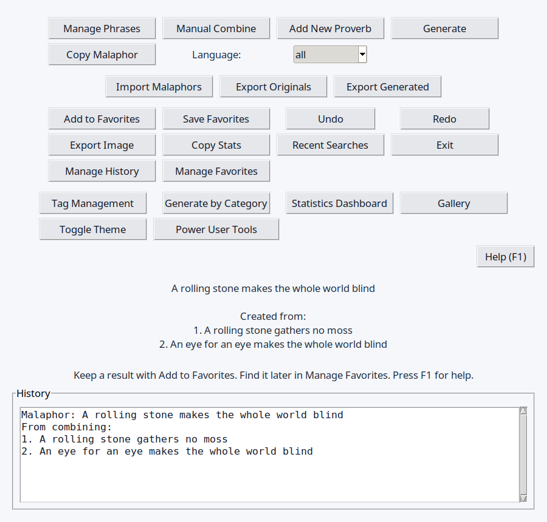
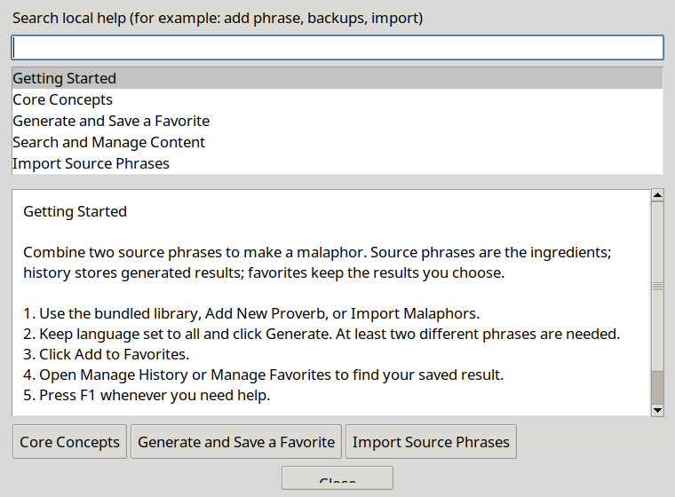

# maliphors-inator

Previously known as **malaphors-rs** and **Malaphors-inator**. See [the rebranding record](REBRANDING.md) for naming, migration, and preserved history.

## Project overview

maliphors-inator is a Python desktop application for generating playful malaphors by combining phrases, idioms, and proverbs. It includes a Tkinter-based graphical interface, a command-line interface, persistence for generated entries, and support for favorites, history, import/export, and phrase searching.

The project is **pre-alpha**, with technical alpha checks passed on 2026-10-01 (214 tests) and human reviews pending. [Alpha](alpha.md) requires working core workflows, sufficiently stable architecture, and demonstrated developer handoff. The independent handoff and human walkthrough remain open. The Python desktop app and CLI live at the repository root; current milestones and gates are published in [ROADMAP.md](ROADMAP.md).

## Screenshots





Captured from the desktop application using disposable sample data on 2026-11-11.

## Features

- Generate random malaphors by mixing the beginning of one phrase with the ending of another
- Manually combine selected source phrases
- Filter generation by category or language metadata when available
- Search the phrase library and browse recent outputs
- Save and review history and favorites
- Import source phrase JSON; export phrases, generated history, and favorites
- Open separate Qt utilities for editing JSON and viewing logs
- Browse generated malaphors in a gallery-style UI
- Use the CLI for generation, source phrase search, and phrase import/export
- Learn with first-launch guidance, a temporary demo, a control tour, guided tasks and searchable offline help (F1)

## Installation

Requirements:

- Initial alpha validation/support scope: Ubuntu 26.04.1 LTS, Python 3.14.4, Tk 8.6.17, and an X11/XWayland display. Other environments are unvalidated; Python 3.10+ remains the code baseline.
- Tkinter for both entry points, plus a graphical display for the desktop app; Linux distributions may require a separate Tkinter package

Install steps:

```bash
git clone https://github.com/richardnoragon/maliphors-inator.git
cd maliphors-inator
python3 -m venv .venv
source .venv/bin/activate
python -m pip install -r requirements.txt
```

Windows setup is unvalidated for this alpha checkpoint. To try it, create the environment with `python -m venv .venv`. Activate it with `.venv\Scripts\Activate.ps1` in PowerShell or `.venv\Scripts\activate.bat` in Command Prompt, then run the pip command above. Install your distribution’s Python venv package if environment creation reports that `ensurepip` is missing.

If `ensurepip` is unavailable and a system `pip` is already installed, this fallback was validated on the alpha environment:

```bash
python3 -m venv --without-pip .venv
pip --python .venv/bin/python install pip
.venv/bin/python -m pip install -r requirements.txt
```

The full [alpha technical validation record](RELEASE_PROCESS.md#alpha-technical-validation-on-2026-10-01) includes the supported environment, recovery tests, and remaining human reviews.

## Daily test launcher on this laptop

Use **maliphors-inator Daily Test** in the application menu or on the desktop. It runs an installed pre-alpha snapshot with separate data and startup backups. See [daily test usage and updates](USER_GUIDE.md#daily-test-version-on-this-laptop).

To install or update the snapshot from this checkout on Linux:

```bash
python3 scripts/install_daily_test.py
```

## Quick start

Launch the desktop app:

```bash
python main.py
```

Generate malaphors from the command line:

```bash
python main.py --generate --count 3
python main.py --generate --count 5 --smart
python main.py --search bird
```

Run commands from the repository root: the phrase library, history, and favorites use files in the current working directory. `python maliphors_inator_cli.py` accepts the same CLI options.

```bash
python main.py --help
python main.py --generate --language en --output-format json
python main.py --import-file incoming.json
python main.py --export originals.json
python main.py --export originals.txt --export-format text
```

Create `incoming.json` using the [user guide example](USER_GUIDE.md#import-format) before running the import command.

Import expects a JSON object with a `proverbs` list; each entry needs `original`, `beginning`, and `ending` strings. Duplicate-only imports return exit code 1. CLI export writes the phrase library; desktop export also supports generated history and favorites. Text exports are for reading, while phrase JSON exports can be imported.

The project is pre-alpha with daily developer testing. See the [milestone note and development gates](ROADMAP.md#release-milestones) and [validation evidence](RELEASE_PROCESS.md#validation-evidence-for-the-next-milestone).

## Architecture overview

The project is organized around a small set of Python modules:

- [main.py](main.py): startup entry point; launches the desktop app or passes CLI arguments to the command-line handler
- [maliphors_inator_cli.py](maliphors_inator_cli.py): argparse-based CLI entry points for generation, search, and export flows
- [maliphors_inator_logic.py](maliphors_inator_logic.py): phrase loading, generation logic, favorites/history management, import/export helpers, and data persistence
- [maliphors_inator_ui.py](maliphors_inator_ui.py): Tkinter-based user interface for the desktop experience
- [malaphors.json](malaphors.json): default phrase database used by the app
- [settings_manager.py](settings_manager.py): settings editor and configuration support
- [log_manager.py](log_manager.py): logging and monitoring interface

## Roadmap

[ROADMAP.md](ROADMAP.md) records pre-alpha milestones, completed automated gates, and pending daily developer checks. Supporting implementation plans live in [.specify/features/improvements-roadmap](.specify/features/improvements-roadmap).

## Documentation and testing

Browse the [documentation index](TOC.md), [FAQ](FAQ.md), and [in-app assistance guide](docs/USER_ASSISTANCE.md).

- [User guide](USER_GUIDE.md): desktop actions, CLI limits, import formats, and backups.
- [Architecture](ARCHITECTURE.md): modules, dependencies, and local data files.
- [Testing](TESTING.md): setup, automated checks, and daily walkthroughs.
- [Security](SECURITY.md): local data boundaries and reporting status.
- [Release process](RELEASE_PROCESS.md): current development gates and later publication steps.

With the virtual environment active:

```bash
python -m pip install -r test-requirements.txt
python -m pytest
```

The full test suite needs a display for Tk; see the testing guide for headless Linux instructions.

## License

This project is currently distributed under a proprietary license. See [LICENSE](LICENSE) for the full terms.

## Contribution instructions

Contributions are welcome. Please follow the project guidance in [CONTRIBUTING.md](CONTRIBUTING.md).

Recommended workflow:

1. Fork the repository and create a feature branch.
2. Make focused changes and update tests where needed.
3. Run the relevant validation checks before submitting a PR.
4. Open a pull request with a clear summary of the change.

Please also keep documentation, release notes, and versioning information aligned with any user-visible changes. The canonical versioning guidance is maintained in [VERSIONING.md](VERSIONING.md).
