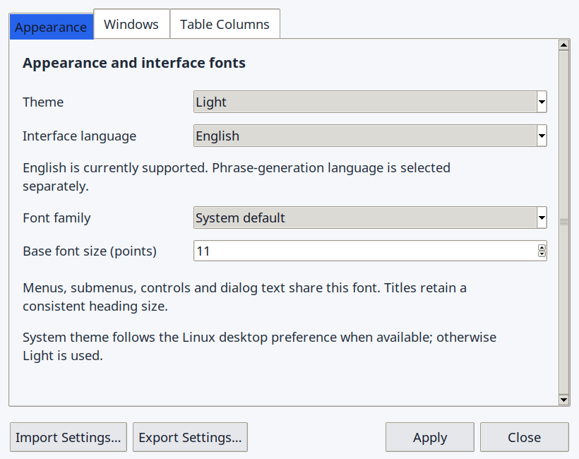
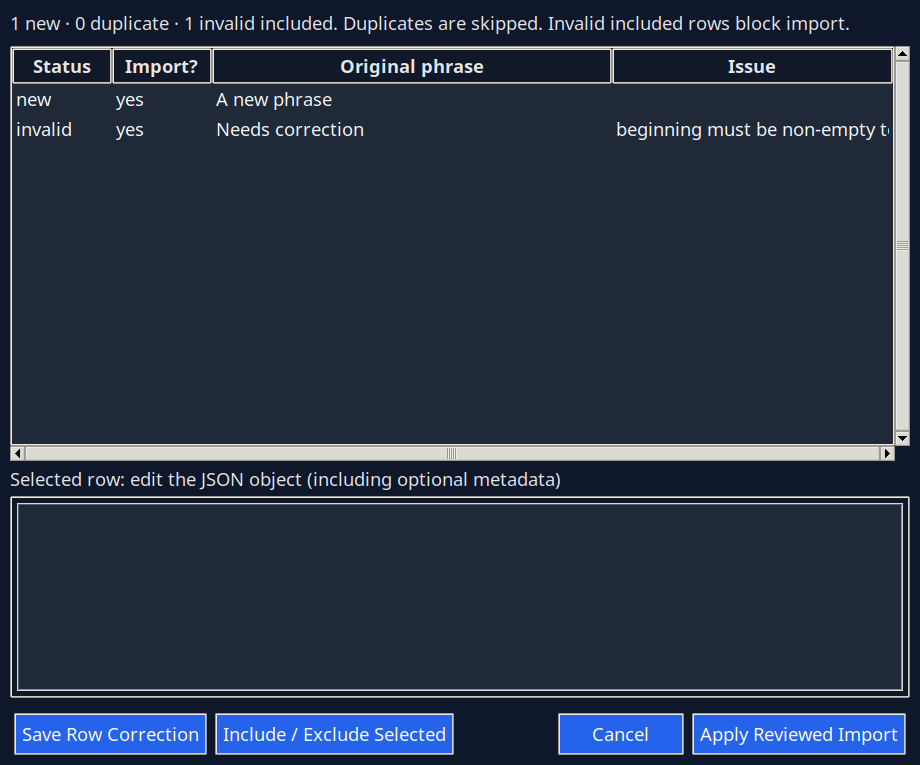

# Interface settings

Added on 2026-11-24 in development version **0.1.0.dev2**. Open **Tools → Interface…**, or search for **Interface Settings** with Ctrl+Shift+P. Changes are saved in the selected data directory's `ui_preferences.json`.

## Appearance and fonts

Choose **Light**, **Dark** or **System**. System follows the GNOME desktop color-scheme preference when available, then the GTK theme environment; if neither supplies a dark preference, it uses Light. While the app is open it checks for system-theme changes every ten seconds. Other Linux desktop environments can use explicit Light/Dark when their preference is unavailable.

Menus and submenus use the same font family and base point size as controls, dialog text, help, lists and tables. Choose **System default** or an installed font, and a size from 8 to 18 points. Titles and headings keep consistent larger/bold roles in that family. Settings tabs scroll when larger fonts need more room. The standalone optional Qt utilities read the same font preference when opened; an already-running separate utility needs reopening. OS-owned native dialogs can follow desktop settings.

**Interface language is English only**, as requested. This is separate from the language selector used to filter phrase generation. No additional translation is claimed.

## Window opening size and location

The Windows tab can remember sizes and locations separately for the main window and ordinary dialogs. Set a default main-window width, height, left and top, or use **Use Current Main Window**. The main window requires at least 760 × 580 pixels. Apply saves explicit geometry changes; appearance-only changes do not move the main window.

Remembered geometry is requested when a window reopens. If remembering size or location is disabled, that part comes from the default opening geometry instead. Saved positions and dimensions are clamped to the current screen. Tooltips and temporary progress windows are excluded.

The desktop window manager retains final placement control. Wayland/XWayland or transient-dialog policies can adjust or ignore a requested position; the app records the actual resulting geometry. Position restoration is therefore best effort on those desktops.

## Table columns and sorting

The current multi-column table is the **import-review table**. Table Columns controls its column order, visibility, pixel widths, sort column and direction. Keep at least one column visible. Up/Down moves a column; checkboxes show/hide it. Widths range from 40 to 1600 pixels.

A heading click toggles ascending/descending sorting, shown by an arrow. Resized widths and sorting are remembered. **Original order** restores input-row order. Sorting does not change row IDs, so corrections and include/exclude actions still apply to the selected source row. The simpler Library/Favorites/History list views do not acquire artificial columns.

## Export and import

**Export Settings…** writes a versioned, project-marked JSON file containing appearance, English interface-language selection, window behavior/geometry and table layout. It excludes phrases, favorites, history, ratings, onboarding completion and unrelated internal preferences. It can export a reviewed draft without changing the active settings. Active state files and the session lock cannot be selected as the destination.

**Import Settings…** validates a maliphors-inator settings file up to 1 MB and loads a draft. Review the tabs, then click **Apply** to save and activate it. Closing without Apply leaves the active appearance unchanged. If the exported font is unavailable, the draft uses System default and tells you. Unsupported interface languages, invalid themes/geometries, unknown table columns, or hiding every column are rejected. A failed save keeps the previous active settings.

Settings exports are separate from data backups and phrase imports. The existing full-data backup format still includes `ui_preferences.json`, and now validates the expanded settings schema, including System theme.

## Scope decisions

CPU/drive thresholds, resource limiting and related notifications are **excluded from this project**, following the maintainer's clarification. No monitoring service or resource-limit configuration has been added.

## Verification

`test_interface_settings.py` covers validation/portability, shared fonts, menu visibility, System theme and backup compatibility, failed saves, best-effort geometry requests, disable-remember behavior, table sorting/row identity and settings import/export drafts. Existing desktop, data, CLI, help and packaging checks continue to apply. Human usability review remains a separate gate.
