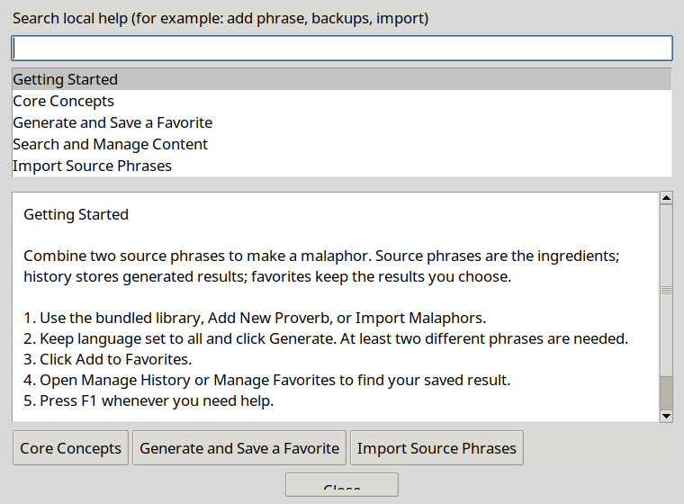

# User assistance standard

maliphors-inator applies the shared Inator outline to its actual phrase-based workflows. Assistance is local and offline. It does not send telemetry, use a remote model, or repair saved data automatically.

## Open help

Use the Help menu, the visible **Help (F1)** button, or F1. The menu has Getting Started, Feature Tour, Guided Tasks, User Guide, Search Help, Troubleshooting, Keyboard Shortcuts, Release Notes, Report Problem and About. Ctrl+Shift+P searches actions. Standard Tab, Space, Enter and Escape navigation is available.

## First launch and onboarding

Getting Started appears on the first normal desktop launch. It explains source phrases, generated history and favorites, then offers Create New Phrase, Import Existing Data and Try Demo. A guided first-result task teaches generation, saving and finding a favorite. The feature tour highlights real controls without operating them automatically. Both can be replayed from Help.

Done / Skip for now stores completion in `ui_preferences.json`, preserving theme and other preference keys. If saving fails, the user gets an error and may retry. A saved-data recovery warning takes priority over onboarding.

Demo runs a separate app process with a temporary working directory and two sample phrases. It does not change the active app's directory or data. Demo data is discarded when that process exits; closing the parent also stops its demo. A forcibly terminated parent may leave temporary files for operating-system cleanup. No demo edits are copied into real data.

## Assistance layers

| Layer | Application behavior |
| --- | --- |
| Orientation | First-launch guide explains the core concepts and first workflow. |
| Tooltips and context | Existing major controls have tooltips; F1 routes phrase/history/favorite/import/export/advanced dialogs to relevant help. |
| Smart empty states | Main window recommends adding/importing or generating; history/favorites explain how to create content. Search Help suggests a shorter term when nothing matches. |
| Interactive tour | A dark mask leaves one real control exposed. Back/Next/Finish/Cancel support replay; cancellation and resizing clear/reposition the mask. |
| Guided tasks | Generation and favorite steps validate saved collection changes; import validates library growth. Manual search/backup/recovery checks require explicit confirmation. Cancelling a guide does not roll back actions already performed. |
| Searchable knowledge base | Articles carry a title, keywords, body and related topic IDs. Search matches all query words across article content, including singular/plural terms and synonyms in keywords. |
| Troubleshooting | Read-only session diagnostics show directory, counts and protected unreadable files. Symptom choices lead to causes, checks, recovery guidance and reporting. |
| Learning and advanced use | Core Concepts and Advanced Concepts explain metadata, categories, generation, persistence and concurrency limits. The action palette finds advanced tools. |
| Discovery | A quiet main-window tip points to relevant next actions; no timed pop-ups or repeated notifications. |

## Seven-part content organization

The searchable topics in `user_assistance.py` use this shared outline:

1. **Getting Started:** application purpose, first launch, first result and navigation (`start`, `generate`).
2. **Core Concepts:** library, phrases, tags/categories, history and favorites (`concepts`).
3. **Common Tasks:** creating/editing, searching, importing and exporting (`generate`, `search`, `import`, `export`).
4. **Advanced Features:** ratings, templates, profiles, persistence and backup (`advanced`, `backup`).
5. **Troubleshooting:** missing/wrong data, malformed imports, write failures, slow operations and recovery (`trouble`, `backup`).
6. **Reference:** shortcuts, file formats, contact/reporting and license (`shortcuts`, `import`, `report`, `about`); User Guide opens the full bundled manual.
7. **Release Notes:** Help → Release Notes opens the bundled changelog.

The generic template's NAS, attachments, hashes and shared-library examples do not describe this app and are not presented as available features. Optional AI-powered help would require a separate decision on provider, costs, consent and data handling; the current framework is complete as an offline system.

## Maintenance and extension

`UserAssistance` owns help windows, the menu, tour masks and demo lifecycle. It calls existing app actions; it has no separate persistence implementation. Add an article to `TOPICS`, include useful keywords and valid related IDs, and update context routing for new screens. Guided steps declare an explanation, action and validation condition; use an explicit manual confirmation only when the system cannot verify the result.

The daily-test installer bundles `user_assistance.py`, `USER_GUIDE.md`, `CHANGELOG.md` and `LICENSE`. Help reads these relative to installed code, independent of the working data directory. If a document is missing, it offers local help rather than failing startup.

## Acceptance checks

Use disposable data. Replay Getting Started and confirm it stays dismissed after reopening. Try the demo and confirm real data stays unchanged. Complete/cancel/replay the tour, resize the main window and check exposed controls. Complete the first-result guide, reopen favorites and verify its saved record. Cancel an import and check the guide does not claim success. Test F1 from an entry in each major dialog, help search/no-results, related articles, palette keyboard navigation, readable light/dark themes and all close buttons at normal font settings. Follow backup guidance with a copy and verify reload after restore.

Automated coverage is in [test_user_assistance.py](../test_user_assistance.py). Human usability review and independent developer handoff remain open [milestone gates](../ROADMAP.md#alpha-readiness).
